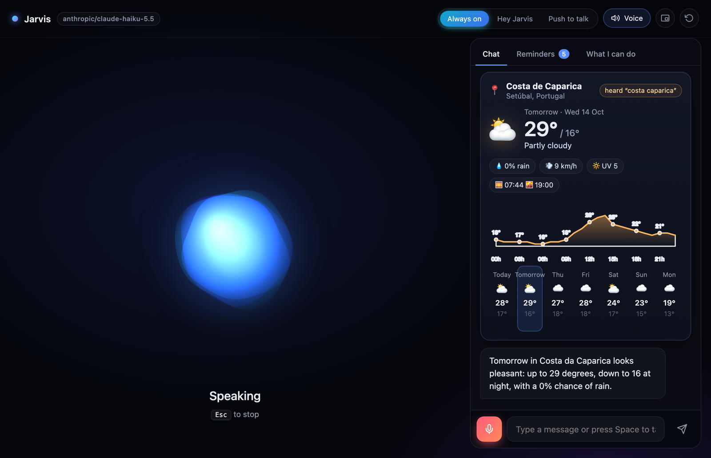
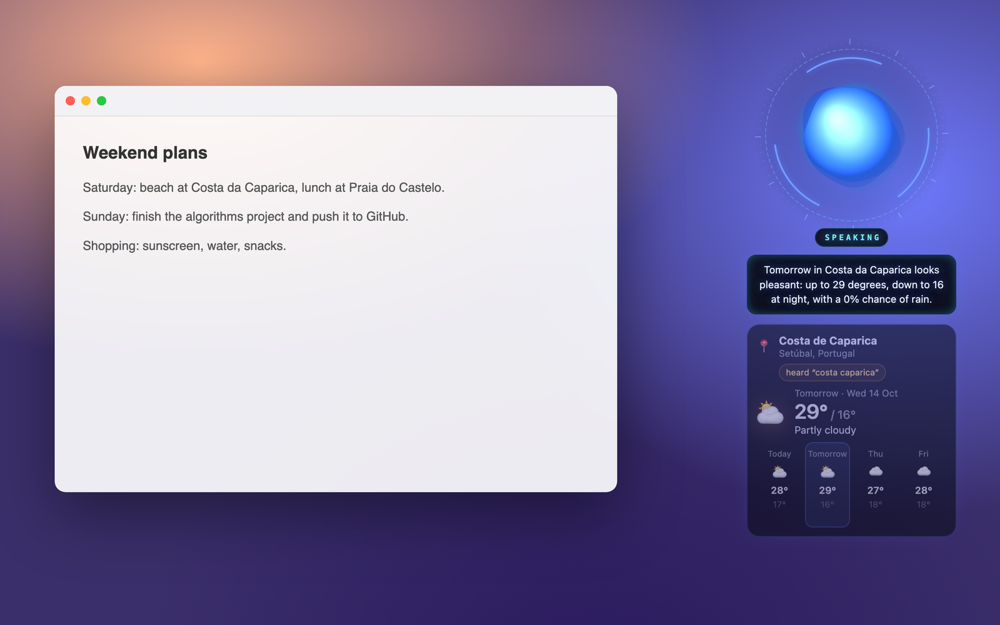
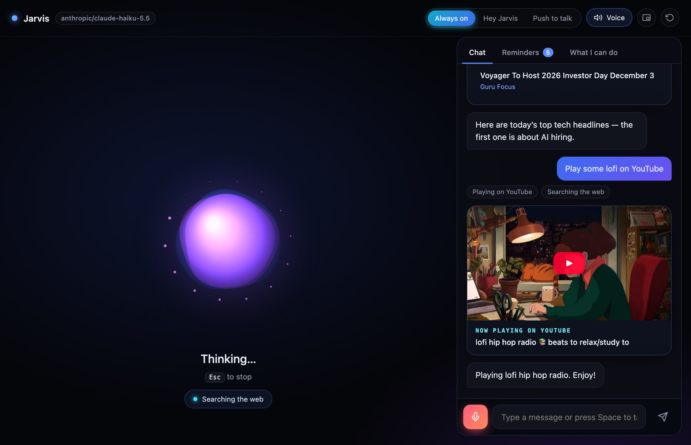
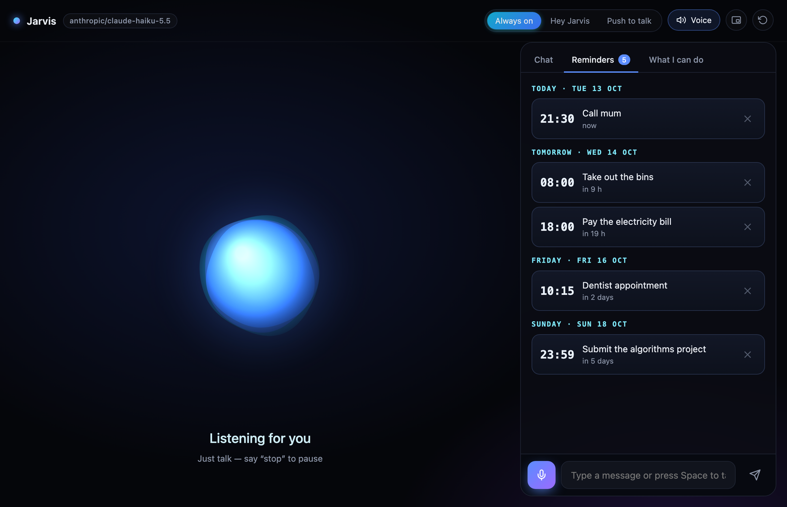
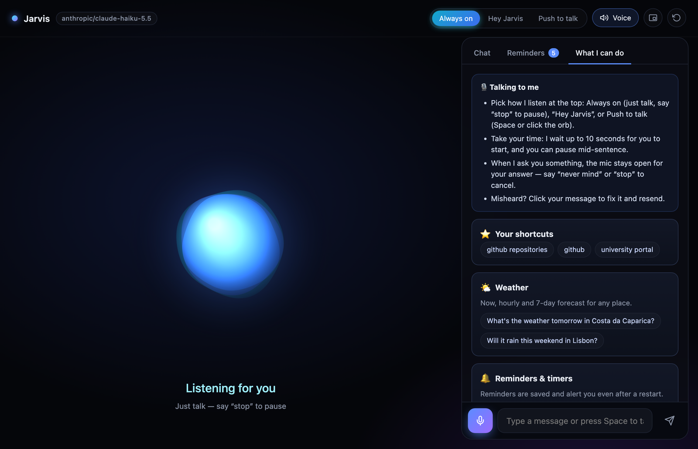

<h1 align="center">🎙️ Jarvis — AI Voice Assistant</h1>

<p align="center">
  A desktop voice assistant powered by AI through <a href="https://openrouter.ai">OpenRouter</a>.<br>
  Just talk: it answers out loud with a natural voice, shows the details as beautiful cards,<br>
  and gets things done — weather, web, news, reminders, folders, apps, YouTube and more.
</p>

<p align="center">
  
  
  
</p>



<table>
  <tr>
    <td width="50%"><br><sub><b>Floating mini mode</b> — a transparent, always-on-top orb with live captions and compact cards.</sub></td>
    <td width="50%"><br><sub><b>Visual cards</b> — news, YouTube, web results, Wikipedia, timers and more.</sub></td>
  </tr>
  <tr>
    <td width="50%"><br><sub><b>Reminders</b> — saved to disk, announced out loud and as a notification.</sub></td>
    <td width="50%"><br><sub><b>What I can do</b> — every skill with example phrases you can click.</sub></td>
  </tr>
</table>

## Features

**Talking**
- 🗣️ **Three listening modes** — **Always on** (just talk; say “stop” to pause and “start listening” to resume), **Hey Jarvis** (local wake word with [openWakeWord](https://github.com/dscripka/openWakeWord)) or **Push to talk** (Space or click the orb). Your choice is remembered.
- 🔁 **Natural turn-taking** — it waits for you to think and tolerates pauses mid-sentence. After an action or answer the mic closes; when it asks you something, it keeps listening for your answer until you reply or say “never mind”. Background noise, fillers and the tail of its own voice are ignored.
- ⚡ **Low latency** — replies stream and are spoken sentence by sentence, so it starts talking before it finishes thinking.

**Seeing**
- 🃏 **Visual cards** — it says the short answer and shows the details: weather with an hourly chart and 7-day forecast, web results, news with images, Wikipedia, YouTube, notes, live timers and system gauges.
- 🎯 **Easy to correct** — cards show what it understood (the weather card says which place it found and offers alternatives), and clicking your own message lets you fix and resend it.
- 🪐 **Floating mini mode** — minimize the window and Jarvis becomes a transparent, always-on-top orb with HUD rings, live captions and compact cards that you can drag anywhere.

**Doing**
- 🛠️ **24 tools** — web search, news, reading pages, Wikipedia, weather, YouTube, folders, apps, websites, shortcuts, volume, battery/CPU, timers, reminders, notes and memory.
- 🔔 **Reminders** — “remind me to call mum tomorrow at 6pm” is saved, listed in the Reminders tab and announced with a spoken alert and a system notification, even after a restart.
- 📂 **Your computer** — “open my Downloads folder”, any folder by name, apps and volume, plus named **shortcuts** (“open my GitHub repositories”) you create by voice.
- 💾 **Memory** — tell it your name or preferences and it remembers them across sessions.
- 🔌 **Any model** — Claude by default; switch to any OpenRouter model with tool calling (including free ones) with one line.

## How it works

```
 Mic ──► wake word (openWakeWord, local)
          │
          ▼
       record until you pause ──► speech-to-text (Google, or Gemini via OpenRouter)
                                         │
                                         ▼
                       Claude via OpenRouter ◄──► tools (weather, search, apps, memory…)
                                         │  streamed text
                                         ▼
                 sentence splitter ──► neural TTS (Edge voices) ──► speaker + orb animation
```

## Getting started

**Requirements:** Python 3.10+ and an [OpenRouter API key](https://openrouter.ai/keys).

```bash
git clone https://github.com/MCCProgrammer/voice-assistance.git
cd voice-assistance

python3 -m venv .venv
source .venv/bin/activate          # Windows: .venv\Scripts\activate
pip install -r requirements.txt

cp .env.example .env               # then paste your OPENROUTER_API_KEY into .env
python main.py
```

> **Free OpenRouter key?** Claude models need credits. Set `MODEL=nvidia/nemotron-3-super-120b-a12b:free` (or any model ending in `:free` that supports tools) to try it at no cost. Free models are limited to a few dozen requests per day.

The first launch downloads the small wake word model (~5 MB). On macOS, allow microphone access for your terminal when asked.

**Controls:** pick a listening mode at the top (Always on · Hey Jarvis · Push to talk). Press <kbd>Space</kbd>, click the mic or the orb to talk · <kbd>Esc</kbd> to stop · or just type. Minimize the window to switch to the floating orb; hover it to expand back or quit.

**Always on** answers every sentence you say (single words and background noise are ignored), so each sentence is one model request — keep that in mind on a free OpenRouter key, and avoid it with a TV or other people talking nearby.

**Wake word not triggering?** Run `python main.py --verbose` and say “Hey Jarvis”: the terminal prints the detection score. If your peaks stay below the threshold (for example with a non-native accent), lower `WAKE_THRESHOLD` in `.env` — try `0.3` — or switch to **Always on**.

## Configuration

Everything lives in `.env`:

| Variable | Default | Description |
| --- | --- | --- |
| `OPENROUTER_API_KEY` | — | Your OpenRouter key (required) |
| `MODEL` | `anthropic/claude-haiku-5.5` | Any OpenRouter model with tool calling. `anthropic/claude-sonnet-5.5` is smarter but slower |
| `ASSISTANT_NAME` | `Jarvis` | Name shown in the app and used in the prompt |
| `VOICE` | `en-GB-RyanNeural` | Reply voice — list them with `edge-tts --list-voices` |
| `LANGUAGE` | `en-US` | Language you speak (e.g. `pt-PT`) |
| `WAKE_WORD` | `on` | Listen for “Hey Jarvis” |
| `LISTEN_SECONDS` | `10` | How long it waits for you to start talking after the wake word (doubled when it is waiting for the answer to a question) |
| `PAUSE_SECONDS` | `1.5` | How long you can pause mid-sentence before it answers |
| `WAKE_THRESHOLD` | `0.4` | Lower = more sensitive wake word. Run with `--verbose` to see your scores |
| `STT` | `google` | `google` (free) or `openrouter` (uses `STT_MODEL`) |
| `STT_MODEL` | `google/gemini-3.8-flash` | Audio-capable model used when `STT=openrouter` |

Memory, notes, reminders and shortcuts are stored in `~/.jarvis-assistant/memory.json`.

## Things to try

- “What's the weather in Lisbon this weekend?”
- “What's new in tech today?” → “Tell me more about the second one.”
- “Play some lofi on YouTube.”
- “Set a timer for 10 minutes for the pasta.”
- “Remind me to take out the bins on Thursday at 8am.”
- “Open my Downloads folder.” · “Save a shortcut called GitHub for github.com/your-name.” → “Open GitHub.”
- “My name is Miguel and I support Benfica.” — then later: “What do you know about me?”
- “Open Spotify and set the volume to 30.”
- “How's my battery?”

Run with `python main.py --verbose` to see every tool call in the terminal.

## Project structure

```
main.py               # starts the desktop window (pywebview) and the JS ↔ Python bridge
assistant/
  controller.py       # conversation loop and app state: idle → listening → thinking → speaking
  brain.py            # Claude via OpenRouter: streaming, tool calls, history
  tools.py            # the tools the model can use
  audio.py            # microphone, voice activity detection, wake word, speaker
  speech.py           # speech-to-text, text-to-speech, sentence splitting
  memory.py           # long-term memory and notes
  config.py           # settings from .env
ui/                   # HTML/CSS/JS interface with the animated orb
```

## Costs

OpenRouter bills per token. With the default Claude Haiku model a typical question costs a fraction of a cent; web searches that read pages use more. Speech-to-text (Google) and the voice (Edge TTS) are free.
