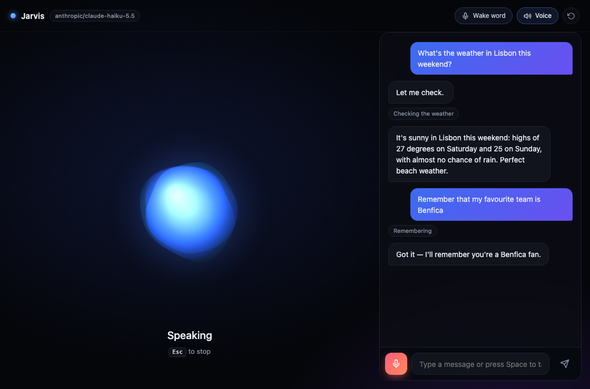

# 🎙️ Jarvis — AI Voice Assistant

A desktop voice assistant powered by **Claude** (through [OpenRouter](https://openrouter.ai)). Say **“Hey Jarvis”**, ask anything, and it answers out loud with a natural neural voice — looking things up on the web, checking the weather, opening apps, setting timers and remembering things about you along the way.



## Features

- 🗣️ **Hands-free** — local wake word (“Hey Jarvis”) with [openWakeWord](https://github.com/dscripka/openWakeWord); nothing leaves your computer until you speak to it.
- 🧠 **Real conversation** — Claude keeps context, follows up, and decides by itself which tools to use.
- ⚡ **Low latency** — replies are streamed and spoken sentence by sentence, so it starts talking before it finishes thinking.
- 🔁 **Follow-ups without the wake word** — after answering it keeps listening for a few seconds.
- 🛠️ **17 tools** — web search, news, reading web pages, Wikipedia, weather, YouTube, opening apps and websites, volume, battery/CPU, timers, notes and long-term memory.
- 💾 **Memory** — tell it your name or preferences and it remembers them across sessions.
- 🎨 **Animated orb** that reacts to your voice and to its own, with a live transcript, tool activity and a text box for when you'd rather type.
- 🪐 **Floating mini mode** — minimize the window (or click the mini button) and Jarvis becomes a transparent, always-on-top orb with HUD rings and live captions that you can drag anywhere.
- 🔌 **Any model** — switch to any OpenRouter model with tool calling by changing one line.

## How it works

```
 Mic ──► wake word (openWakeWord, local)
          │
          ▼
       record until you pause ──► speech-to-text (Google, or Gemini via OpenRouter)
                                         │
                                         ▼
                       Claude via OpenRouter ◄──► tools (weather, search, apps, memory…)
                                         │  streamed text
                                         ▼
                 sentence splitter ──► neural TTS (Edge voices) ──► speaker + orb animation
```

## Getting started

**Requirements:** Python 3.10+ and an [OpenRouter API key](https://openrouter.ai/keys).

```bash
git clone https://github.com/MCCProgrammer/voice-assistance.git
cd voice-assistance

python3 -m venv .venv
source .venv/bin/activate          # Windows: .venv\Scripts\activate
pip install -r requirements.txt

cp .env.example .env               # then paste your OPENROUTER_API_KEY into .env
python main.py
```

> **Free OpenRouter key?** Claude models need credits. Set `MODEL=nvidia/nemotron-3-super-120b-a12b:free` (or any model ending in `:free` that supports tools) to try it at no cost. Free models are limited to a few dozen requests per day.

The first launch downloads the small wake word model (~5 MB). On macOS, allow microphone access for your terminal when asked.

**Controls:** say “Hey Jarvis”, press <kbd>Space</kbd>, click the mic or the orb to talk · <kbd>Esc</kbd> to stop · or just type. Minimize the window to switch to the floating orb; hover it to expand back or quit.

**Wake word not triggering?** Run `python main.py --verbose` and say “Hey Jarvis”: the terminal prints the detection score. If your peaks stay below the threshold (for example with a non-native accent), lower `WAKE_THRESHOLD` in `.env` — try `0.3`.

## Configuration

Everything lives in `.env`:

| Variable | Default | Description |
| --- | --- | --- |
| `OPENROUTER_API_KEY` | — | Your OpenRouter key (required) |
| `MODEL` | `anthropic/claude-haiku-5.5` | Any OpenRouter model with tool calling. `anthropic/claude-sonnet-5.5` is smarter but slower |
| `ASSISTANT_NAME` | `Jarvis` | Name shown in the app and used in the prompt |
| `VOICE` | `en-GB-RyanNeural` | Reply voice — list them with `edge-tts --list-voices` |
| `LANGUAGE` | `en-US` | Language you speak (e.g. `pt-PT`) |
| `WAKE_WORD` | `on` | Listen for “Hey Jarvis” |
| `WAKE_THRESHOLD` | `0.4` | Lower = more sensitive wake word. Run with `--verbose` to see your scores |
| `STT` | `google` | `google` (free) or `openrouter` (uses `STT_MODEL`) |
| `STT_MODEL` | `google/gemini-3.8-flash` | Audio-capable model used when `STT=openrouter` |

Memory and notes are stored in `~/.jarvis-assistant/memory.json`.

## Things to try

- “What's the weather in Lisbon this weekend?”
- “What's new in tech today?” → “Tell me more about the second one.”
- “Play some lofi on YouTube.”
- “Set a timer for 10 minutes for the pasta.”
- “My name is Miguel and I support Benfica.” — then later: “What do you know about me?”
- “Open Spotify and set the volume to 30.”
- “How's my battery?”

Run with `python main.py --verbose` to see every tool call in the terminal.

## Project structure

```
main.py               # starts the desktop window (pywebview) and the JS ↔ Python bridge
assistant/
  controller.py       # conversation loop and app state: idle → listening → thinking → speaking
  brain.py            # Claude via OpenRouter: streaming, tool calls, history
  tools.py            # the tools the model can use
  audio.py            # microphone, voice activity detection, wake word, speaker
  speech.py           # speech-to-text, text-to-speech, sentence splitting
  memory.py           # long-term memory and notes
  config.py           # settings from .env
ui/                   # HTML/CSS/JS interface with the animated orb
```

## Costs

OpenRouter bills per token. With the default Claude Haiku model a typical question costs a fraction of a cent; web searches that read pages use more. Speech-to-text (Google) and the voice (Edge TTS) are free.
